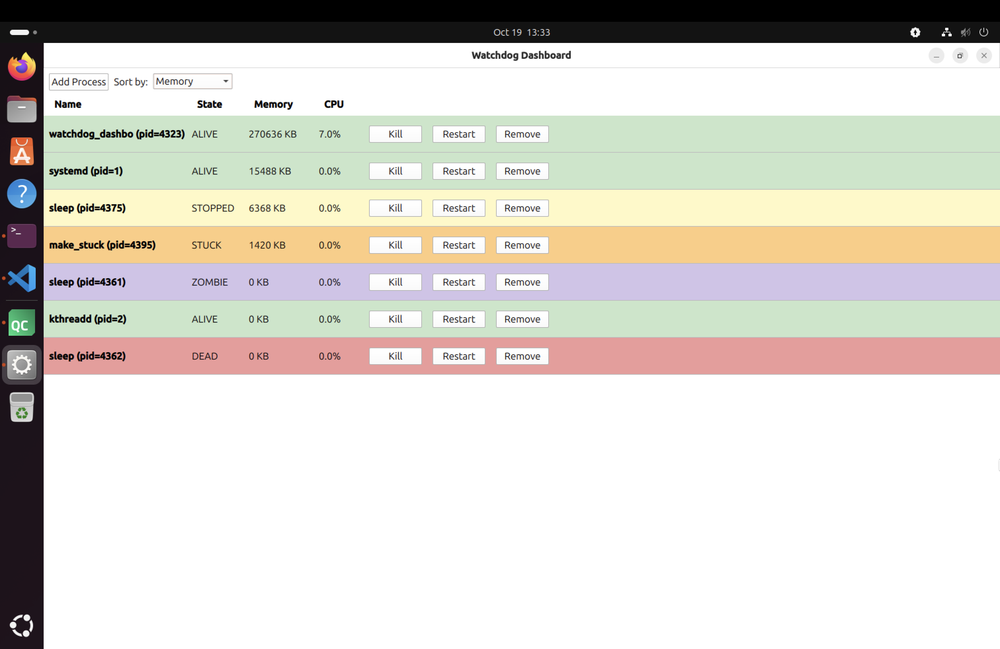

## Credits

This repository is a fork of [**Universal Watchdog**](https://github.com/studentprojectszuhlke/universal_watchdog), a C++17 Linux process and thread monitoring tool built by a team of four students in the **Zühlke C++ Mentorship Program** (April-May 2026), mentored by **Božica Kalinić**.

**Original team:**
- [David Ćuruvija](https://github.com/davidcuruvija)
- [Danilo Nikolaš](https://github.com/ndanilo02)
- [Lana Matić](https://github.com/lanamatic)
- [Zagorka Pantović](https://github.com/zpantovic)

The original project contains the monitoring engine, process and thread monitors, logger and the interactive terminal interface.

**What's new in this fork:** a Qt6/QML dashboard, built by David Ćuruvija on top of the original `watchdog_core` library. The core monitoring code is unchanged.

# C++ Universal Watchdog

A robust and interactive watchdog system written in modern C++ that monitors processes and embedded threads, detects granular failures (crashes, freezes, I/O deadlocks), and provides a live CLI tracking interface with background logging.

## Demo Videos

- [Live Demo: Thread & Process Monitoring] https://youtu.be/Qjd-Qn36Msw
- [Project Walkthrough: Architecture & Design] https://youtu.be/PeGOuqn_2x8

## QML Dashboard



A Qt6/QML GUI built on top of the same `watchdog_core` library as the terminal
app above - live process list, color-coded by state, refreshing every second.

- **Live view**: auto-refreshing list with per-process name, state, memory, and CPU
- **Process control**: kill, restart, remove, or add a process by PID, all from the UI
- **Sortable**: sort by name, memory, or CPU usage
- **Color-coded states**: `ALIVE` (green), `STOPPED` (yellow), `STUCK` (orange), `ZOMBIE` (purple), `DEAD` (red)

### Build & Run
```bash
cmake --build build --target watchdog_dashboard
./build/qml_dashboard/watchdog_dashboard
```

## Features
- **Process Control Interface**: Direct process manipulation enabling you to kill or restart monitored processes directly from the dashboard.
- **Resource Tracking & Sorting**: Real-time tracking of CPU and Memory utilization with the ability to sort the process list by resource consumption.
- **Granular Process Monitoring**: Tracks processes via PID directly from Linux `/proc`, recognizing `ALIVE`, `STOPPED`, `ZOMBIE`, `DEAD`, and `STUCK` (D-state I/O hangs).
- **Intelligent Thread Monitoring**: Tracks embedded application threads via a heartbeat mechanism, dynamically identifying `ALIVE`, `STUCK`, `ZOMBIE`, and `DEAD` states.
- **Interactive REPL Terminal**: Offers an intuitive CLI with commands (`add process`, `remove`, `list`, `watch`, `config`, `clear`, `help`).
- **Live "Watch" Engine**: A beautiful, color-coded, auto-updating table with ANSI in-place refresh. Automatically freezes historical "snapshots" in your terminal history when state changes occur.
- **Smart Logging**: Background logger writes to file only on state transitions or periodic summaries, preventing log spam.
- **Terminal-Aware**: Dynamically adjusts to terminal dimensions to prevent visual corruption. Prevents duplicate entity registration.

## Architecture
The system is built around these core components:

- **Watchdog Engine**
  - Runs in the background, synchronizes health checks, logs state transitions, and serves data to the UI.
- **Terminal Renderer**
  - Manages the interactive prompt, ANSI UI styling, frozen snapshots vs. live views, and user input parsing.
- **Watchable Interface**
  - Abstract interface for anything that can be monitored.
- **Monitors**
  - `ProcessMonitor`: Interprets raw `/proc/[pid]/stat` status codes and timing.
  - `ThreadMonitor`: Utilizes a concurrent timeout window and checks kernel existence to map thread health.

## Build & Run Instructions

### Requirements
- C++17 or newer
- Linux
- g++
- CMake (3.16+)

### Build & Run

```bash
mkdir -p build
cd build
cmake ..
make

# Start the interactive terminal:
./watchdog_app
```

### Running Tests

```bash
./build/tests/watchdog_tests
```

## Limitations
- Linux-only (relies heavily on `/proc` filesystem and POSIX syscalls).
- External Thread Monitoring via CLI currently requires an IPC implementation (threads are monitored embedded-style).
- Polling-based (not event-driven).
